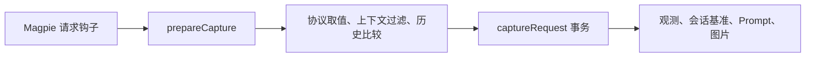
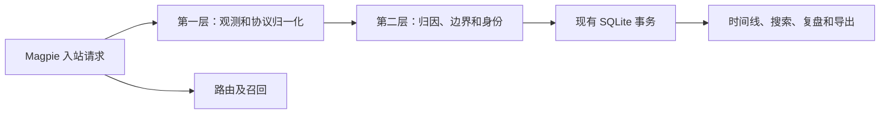

# Magpie 实时输入归因设计

## 目标

从经过 Magpie 的请求中识别可归因的本轮用户输入，统一不同协议的处理方式。验收时分别验证正文和附件归属、新旧消息的边界、跨请求的身份，并保留现有卡片 ID。历史导入继续由独立任务处理。[本机历史导入设计](native-history-import.md)

## 修改前结构

`prepareCapture` 原先在同一文件里按协议取得输入项、过滤 Agent 上下文、解析图片、计算请求签名并判断会话历史是否有新增。会话基准包含有序摘要。`captureRequest` 在事务内读基准和已见签名，然后写入观测与卡片关联。旧卡片的证据字段同时承担了身份与输入归因的展示。临时上下文一旦被误纳入历史摘要，客户端在后续请求中省略它就可能使同会话持续漏收。[网关解析](../gateway-input.js) · [存储事务](../submissions.js)

## 修改后结构

两层是同一个钩子里的职责划分。`gateway-protocol.js` 将协议请求转换为有序消息和内容块，`gateway-input.js` 据此决定哪些内容可进入日记。插件优先读取宿主在异步钩子链改写之前提供的 `ctx.inboundBody`。旧宿主沿用钩子处理顺序，并识别 deja-vu 扩展的完整召回包装。宿主源码会把前置钩子返回的请求体交给后续钩子。生产观测只保存日记所需字段和处理结果，完整请求体仅用于按会话开展短时排查。[Magpie 钩子实现](https://github.com/XmchxUp/magpie/blob/9994da82/internal/plugin/host.js#L1298)

| 维度 | 修改前 | 提议结构 | 为什么改 |
| --- | --- | --- | --- |
| 协议适配 | `prepareCapture` 直接读各协议的 JSON | 按协议适配为有序消息和块，保留载荷位置和未知类型 | 同一协议可服务多个 Agent，测试能单独验证消息与块的边界 |
| 来源判断 | 协议角色、宿主用途、已知正文标记共同决定候选 | 分开记录请求用途、块来源及判定依据 | `role: user` 可能承载诊断、压缩摘要和召回，也可能含多种来源的块 |
| 新增与身份 | 作用域内的消息 ID、请求签名和历史前缀 | 先判断块归属，再判断新增边界，最后按有作用域的提交身份关联 | 请求重放与独立同文输入需要不同的处理 |
| 生命周期 | 页面消费写入后的卡片，历史比较保留上次基准 | 沿用 SQLite 事务和页面读路径，历史摘要基于归一化的稳定输入 | 排除临时块导致的基准漂移，保留旧卡片的收藏和标签 |

### 第一层保留哪些信息

- 每个请求保留 `protocol`、`agent`、`origin`、`session`、时间和可用的宿主请求 ID、用途。
- 每个消息保留协议角色、作用域内的消息 ID、顺序与内容块；块保留类型与原请求位置。文本、实际收到的图片与外部引用各自保留类型。Responses 中的工具结果和续跑字段、Anthropic `user` 里的 `tool_result`、Gemini 的 `functionResponse` 都按协议区分。
- 新类型保留为 `unknown`。适配器按协议选择，通过有依据的 Agent 或扩展规则解释少数特殊封装，业务层使用同一输出契约。

### 第二层独立回答三个问题

1. **谁提供了这些内容？** 首选能与客户端提交入口关联的来源和内容边界。宿主的后台请求用途、协议的系统和工具字段、已知且具边界的客户端封装可用于识别自动内容。缺少人类提交证据时保留推断依据。已识别且独立的召回块可剔除，和正文混在一起且无法可靠切分的内容保留为待确认。只有能还原的用户文本和对应附件才作为原始输入发布。
2. **这个输入本轮是否首次出现？** 优先使用已确认的新提交关联。其次使用受支持的增量语义和同一会话稳定的历史边界。工具续跑只关联既有输入。历史压缩或重置且无法确认新增边界时重建或保留基准，跳过无法确认的新卡片。归一化后的边界和证明请求重放的签名分别使用，避免把相同正文当成同一次提交。
3. **它和哪张卡片是同一条？** 提交 ID 只有在发行方及会话作用域明确、且能证明跨协议一致时才可跨协议关联。同一稳定提交 ID 的多次观测关联一张卡片。请求 ID 只区分网关请求。没有共同身份时，同文和时间接近不足以合并记录。确凿的人类来源、消息身份和新增边界分别保存依据。

发布策略沿用正式日记的可识别输入原则。可核实的人类提交正常入库，有明确边界但缺少客户端证明的输入仍可按网关推断收录，并标出依据。用途、归属或新增位置有歧义时，只留观测结果及原因。没有更多上游证据时，两次相同的载荷可能对应真实用户再次提交，也可能对应重放，因此覆盖率和准确率应按 Agent、协议与传输入口分别验收。

## ContextSpy 的适用范围

ContextSpy v0.6.3 把最后一个未标记为预填充的 `USER_MESSAGE` 位置作为候选，匹配文件启发式的块优先归入文件内容。它的分类用于统计上下文构成。该规则会把某些 `role: user` 的自动摘要误判为当前消息，在工具续跑中也会重新指向上一条用户输入，用户亲手粘贴的大段代码则可能被归为文件内容。可以借鉴它的块级分类和原请求位置，用来做离线对照。正式日记的归因、去重和入库仍由插件处理。此判断来自版本源码核对。[分类器](https://github.com/RimantasZ/contextspy/blob/v0.6.3/contextspy/analysis/classifier.py#L96-L127) · [协议适配器](https://github.com/RimantasZ/contextspy/tree/v0.6.3/contextspy/analysis/adapters)

## 兼容与验收

| 样本 | 预期 |
| --- | --- |
| 同一轮请求包含用户正文、手贴代码、图片和召回内容 | 保留正文、代码和用户图片，排除已识别的召回和工具内容 |
| Pi 自动摘要、T3 标题或子 Agent 请求伪装成 `user` | 有用途或结构证据时只保留观测 |
| 工具续跑、重试、同文两次发送 | 有共同身份的请求关联同一张卡片；能区分的两次提交分别收录 |
| 客户端缩短历史、重排消息或发来未知块 | 仅按已证明的边界收录；其余可从观测原因排查 |
| 改变扩展加载顺序，或同一请求走 HTTP 和 WebSocket | 有宿主入站视图时采集结果独立于召回顺序。不同入口按相同契约单独验收 |
| 加载现有日记库 | 卡片 ID、项目与 Agent 筛选、Markdown、图片、收藏、标签、复盘和导出可复用 |

新卡片在原有身份依据之外，可记录 `provenance.source`、`boundary` 和 `requestView`，分别说明归因等级、首次收录依据和使用的请求视图。现有卡片可继续通过原证据字段展示，历史摘要保留原有请求项形状，以兼容现有会话基准。Magpie 侧补丁为钩子提供按需复制的 `ctx.inboundBody` 和每次钩子运行的 `ctx.requestId`。真实用户提交身份仍需客户端与宿主共同提供可核实的提交来源及内容边界。
