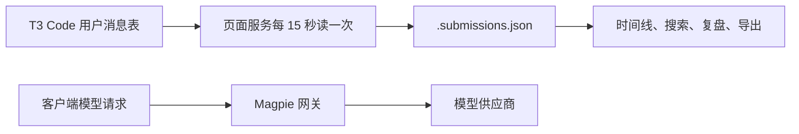
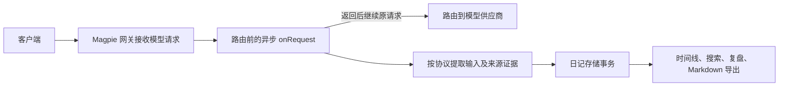

# Prompt Diary 的 Magpie 网关采集架构

本文记录从 T3 快照切换到 Magpie 网关实时采集的设计。当前插件已接入 `onRequest` 和本地 SQLite 存储。

## 1. 目标与边界

Prompt Diary 是 Magpie 插件。**正式日记里的每条 Prompt 都应能追溯到至少一次经过当前 Magpie 网关的模型请求。** 增量采集使用网关的异步请求钩子，Codex、Pi、Claude Code 等客户端共用这条入口。推理协议决定如何解析请求，Agent 名称用于展示和筛选。

记录的时间是网关首次观测到输入的时间。经网关收到新输入时，即使模型随后超时、失败或取消，也可以留下记录。客户端绕过网关的输入、尚未发给模型的消息，以及客户端本地保存的草稿在采集范围之外。复盘继续由用户主动触发。

## 2. 旧实现与问题

旧版 `readT3Submissions()` 直接读取 T3 SQLite 投影，按 `createdBy=user` 和 Web、Mobile 渠道挑选消息。`server.js` 定时重建快照，身份用 `source + T3 threadId + messageId`。这个实现能解释 T3 中谁提交了什么。用户通过 T3 发出但未经过 Magpie 的内容仍可能入库，独立运行的客户端即使每一轮都经过 Magpie，当前也没有入口。见 [旧版 T3 读取入口](https://github.com/ChenWoChong/mag-review/blob/6561de6/t3-submissions.js)、[旧版定时同步](https://github.com/ChenWoChong/mag-review/blob/6561de6/server.js)。

早期版本曾在 `onRequest` 里写 `ctx.query`，用用户文本和它在请求历史里的出现次数去重。Pi 的自动诊断会以模型协议的 `user` 角色出现，正文变化时指纹也变化。历史缩短时，同一次提交的指纹可能变化，两次独立发送相同文本的增量请求也可能得到相同指纹。网关采集应恢复，原先的文本身份规则应替换。见 [旧采集实现](https://github.com/ChenWoChong/mag-review/blob/82fdbb8/prompt.hooks.js#L29)。

## 3. Magpie 能提供的信息

| 接口或数据 | 可用信息 | 设计用法 |
| --- | --- | --- |
| `onRequest(body, ctx)` | 路由前的客户端协议 JSON。已知契约提供 `protocol`、`origin`、`agent`、`session`、`cwd`、`query` 等字段 | 实时采集的唯一入口。正文和附件按协议解析，`ctx.query` 作为网关提取的文本提示 |
| `onResponse(reply, ctx)` | 尽力送达的结束通知和 `success`。可通过 `ctx.state` 与同一次调用关联 | 主链路在收到输入时完成。以后如需显示请求结果，可用此回调更新状态 |
| `usage.jsonl` | 本机样本含时间、Agent、会话、路由 ID、状态等运营数据 | 核对覆盖与时间。路由 ID 只有在钩子明确提供同一标识时才可直接关联 |
| `gateway-conversations/*/turns.jsonl` | Magpie 可选保存的归一化交换，受保留期、截断和会话可用性影响 | 排查采集差异。旧日志缺少可靠输入身份，实时方案无需依赖此功能 |

`ctx.query` 在已查阅的 Magpie 源码中由对话协议提取自末尾可用的 `user` 文本。`role: user` 表示请求里的角色，实际发送者可能是人、扩展或客户端后台任务。网关能证明请求经过本机网关，只有额外的请求用途或输入来源字段才能提高归因准确度。两个请求如果在网关可见的字段上完全一致，一个可能是重试，另一个也可能是用户再次发送了相同文本。

本机运行的是 Magpie `0.1.4709`。本地 Magpie 源码检出与运行版本不同，因此表中列的是已查阅的公开钩子契约。已实测 Chat、Responses、Messages、Gemini、Codex HTTP 直通与两个 Responses WebSocket 入口均调用钩子。测试请求看到了 `kind` 和 `caller`，未看到通用的 `requestId` 或 `turnId`。当前插件按钩子调用生成观测 ID。抽查本机 2026-11-23 的已保存交换时，455 条 Pi 和 441 条 T3 样本均带截断标记，且样本 `input` 均无 `user/text` 部分。这足以说明回填旧日志无法替代实时采集。上游参考见 [异步请求钩子](https://github.com/XmchxUp/magpie/blob/9994da82/docs/subsystems/gateway-request-hooks.md)、[请求上下文实现](https://github.com/XmchxUp/magpie/blob/9994da82/internal/gateway/middleware.go#L87)、[网关会话留存](https://github.com/XmchxUp/magpie/blob/9994da82/docs/subsystems/gateway-sessions.md)。

## 4. 目标结构

`package.json` 重新声明 `magpie.hooks`。钩子负责接收请求、提取所需字段、交给存储并返回 `undefined`。页面服务读同一份日记存储，负责筛选、展示和标注。现有 Markdown 渲染、图片预览和复盘流程继续复用。

### 4.1 数据对象与索引

| 对象 | 建议字段 | 身份规则 |
| --- | --- | --- |
| 请求观测 | `captureId`、`observedAt`、`origin`、`agent`、`protocol`、`session`、`cwd`、`requestKind`、处理结果 | 有稳定且经验证的网关请求 ID 时使用它。字段缺失时，每次钩子调用生成内部 ID，唯一性只覆盖这次调用 |
| Prompt | `id`、`text`、`attachments`、`observedAt`、`session`、`agent`、`cwd`、`evidence` | 有稳定的提交或消息 ID 时，按来源命名空间、会话和该 ID 唯一。无稳定 ID 时，用首次观测 ID 加请求内输入位置生成记录 ID |
| 请求与 Prompt 的关联 | `captureId`、`promptId` | 同一 Prompt 可关联多个请求。一个请求也可带来多条新输入 |

当前用本地 SQLite 保存这三类数据。钩子并发写入由事务与唯一索引处理，页面按 `observedAt, id` 稳定分页。会话比较仅使用有限的有序消息摘要，并以会话作用域为键。摘要服务于历史边界判断，完整请求体、系统指令、工具结果和模型回复无需保存在日记中。保留用于验收的非正文结果，例如已收录、已关联、来源未确认、写入失败和超限。

`requestId` 标识请求，输入 ID 标识用户消息。`turnId` 可以辅助约束候选范围。一个运行中可能有多条用户补充，因此仅有 `turnId` 时还需要消息 ID 或该协议明确保证稳定的输入位置。缺少会话 ID 时，候选记录保留独立身份，跨请求去重需要另外的可靠标识。项目展示优先使用网关提供的 `cwd`，缺少目录则归为未知项目。Agent 未识别时显示未知 Agent。

### 4.2 新输入识别和去重

1. **先看请求用途。** 若宿主或经过验证的协议元数据明确标识自动标题、系统压缩、内部任务或复盘请求，记录处理结果即可。已知自动请求的识别依据应来自结构化用途字段。包含这类词语的用户正文仍按正常输入处理。
2. **再解析实际输入。** 为 Chat Completions、Responses、Anthropic Messages 和 Gemini 各实现协议适配器，将消息及内容块转成有序的候选、已知工具内容、已知系统上下文。文本按块保留。图片只在网关实际收到可读取字节时保存，按正文所属输入关联，限制大小和类型。仅图片也可以构成一条 Prompt。对于 URL 或客户端路径只保留网关提供的引用描述。
3. **按可靠输入 ID 写入。** 先尝试查找同一作用域已有 Prompt。存在时关联当前请求，缺失时写入新记录。网关内部供应商重试视为同一个客户端请求。客户端重连或重发是否复用输入 ID，由具体协议和版本测试确认。
4. **按已知历史边界处理无 ID 输入。** 单条明确的协议用户输入可以收录为「网关推断」。对已跟踪的完整历史，只在同一会话存在可信的精确前缀且顺序已确认时收录新增后缀中的用户输入。比较完整的有序消息结构，避免把工具结果或助手回复变化当成新提交。保存的边界随事务更新。并行请求、压缩、重开或历史回退导致边界不确定时，不能仅用时间最近、正文相同或子串次数认定同一提交。
5. **明确处理信息不足的请求。** 首次见到一个带历史的会话只处理有新输入证据的部分。已有观测后，如果相同的无 ID 请求缺少可区分的新输入边界，仅保留新的网关观测和原因。待确认观测默认不计入正式时间线或复盘。能识别新增边界但无法识别发送者时，只能标为「网关推断」，包括部分客户端扩展注入。将来可根据实际覆盖率评估是否提供单独的待确认视图。

若 T3 将交接摘要和本轮用户输入放在同一文本块，只有经过验证的结构化字段或带独立边界的协议块才能拆分。混合载荷来源不明时走第 5 步。长远可向 Magpie 增加兼容的钩子字段，例如网关 `requestId`、请求用途、客户端提交引用和输入来源标签。每个字段允许缺失。宿主负责投影所需元数据，插件继续通过网关读取，客户端配置、原生会话文件和 T3 数据库无需参与。

## 5. 结构变化对比

| 维度 | 当前 | 目标 | 收益 |
| --- | --- | --- | --- |
| 数据来源 | T3 SQLite 投影 | Magpie 实时请求钩子 | 所有收录都能证明经过网关，独立客户端可走同一入口 |
| 记录身份 | T3 thread ID 与消息 ID | 网关观测 ID 与有来源证据的输入身份 | 一次请求和一次用户提交可以独立追踪 |
| 去重索引 | 快照按 T3 消息身份更新 | 事务内按稳定输入 ID 写入，请求关联单独索引 | 保留真实同文输入，处理重试和重复回调 |
| 生命周期 | 页面服务每 15 秒重读整库 | 钩子逐请求写入，页面读取同一份记录 | 与请求到达时间直接对应，省去整库轮询 |
| 附件来源 | 读取 T3 附件文件 | 从经网关的请求内容归属和提取 | 附件证据与网关正文一致 |

## 6. 运行、兼容和迁移

- **启用与来源。** 启用插件即启用日记钩子。个人实例默认收录宿主确认的本机请求。共享、远程或无法确认来源的流量是否收录通过插件选项明确配置。`origin` 只用于采集范围配置，和是否为新输入是两个判断。上游运行版本对自用受管密钥的标记需要实测，避免本机正常请求被意外漏掉。
- **失败与并发。** 钩子只进行有界解析和本地写入。超限、锁超时、磁盘错误和插件退出都可能漏记，模型请求按网关钩子的失败语义继续。持久化事务要么写入完整元数据及关联，要么回滚。附件采用内容哈希文件名、原子落盘后提交引用，清理超限和无引用文件时避开写入中的附件。禁止用无界内存队列弥补写入压力。
- **保留与关闭。** 使用插件自己的保留配置和目录权限管理日记。关闭插件即停止新的采集，已落盘记录可由日记自身管理。请求体中的认证信息、工具结果与系统上下文不进入日记。读取和复盘沿用本机访问限制。手动生成复盘的请求要带可识别的内部用途标记，避免把复盘输入采集回日记。
- **切换现有数据。** 新日记写入独立存储，旧 `.submissions.json`、旧 Markdown 及历史报告可保留为备份。旧 T3 条目缺少与网关输入的可靠关联，不能按正文拼接到新日记。模板可独立迁移，旧标注和引用只有在记录身份能校验时才迁移。旧日志回填属于单独的可选阶段，须按来源、保留期和截断程度提示覆盖范围。
- **范围。** 本方案为最佳努力的日记。旧版宿主未暴露的请求路径、没有上报的输入块、被截断的历史和没有来源信息的内容构成覆盖边界。首阶段维持模型请求协议与路由行为，后续扩展仅增加可选钩子元数据。

## 7. 验收和实施顺序

| 验收场景 | 预期结果 |
| --- | --- |
| 同一客户端分别经 Magpie 发一条、绕过网关发一条 | 只出现经网关且有新输入证据的一条。关闭 T3 或移走测试环境的客户端原生会话文件仍能采集 |
| Chat、Responses、Messages、Gemini；另查 Codex WebSocket 和直通入口 | 为每条路径记录是否调用钩子、可见身份字段和来源标记。只承诺实测通过的入口 |
| 工具续跑、供应商重试和同一消息重复回调 | 已确认的稳定 ID 只产生一条 Prompt。无 ID 的工具续跑在历史边界已知时不新增记录 |
| 两次同文输入 | 两个稳定输入 ID 或明确的新输入边界产生两条。只有相同请求文本时保留未确认结果 |
| Pi 诊断、T3 交接、自动标题、真正粘贴相似前缀 | 有用途证据的自动请求不生成 Prompt。混合文本按结构拆分或保留未确认原因。用户提交的原文按输入证据保留 |
| 纯图片、长文本、断开、写入失败或重启 | 文件可用时支持纯图片。超限状态可解释，失败时网关仍转发，重启后稳定身份和关联仍生效 |
| 页面、搜索、复盘与导出 | 四个入口读取同一份已收录的记录。复盘提交不会回采集 |

1. 先做隔离的兼容性验证。用虚构输入记录各模型入口触发次数、可见字段和钩子预算，只输出字段名和计数。明确本机受管连接和共享连接的 `origin` 值。
2. 接入异步钩子、协议解析和本地事务存储。将页面和复盘切到新存储，移除 T3 轮询。用虚构输入验证旁路隔离、重复以及失败语义，并对比启用前后的请求延迟。
3. 根据覆盖数据决定是否补 Magpie 的请求用途和提交引用。对确实走网关、但当前钩子覆盖不到的传输先补宿主入口，再纳入采集承诺。最后评估现有网关记录能否有限回填。
