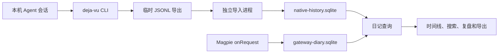

# 本机 Agent 历史导入

安装 Prompt Diary 时一并安装 `@vshulcz/deja-vu`。日记页面服务启动后，首次导入由后台进程执行。deja-vu 负责发现与解析本机 Agent 会话，Prompt Diary 负责筛选导出的用户输入和保存日记记录。

## 运行方式

- 页面服务开始监听后才启动导入进程。网关钩子继续写实时库，页面可以立即访问。首次成功发布后，再次启动会跳过导入。设置插件选项 `importHistory: false` 可以关闭自动执行。
- 用 `npm run --silent import-history` 预览。加 `--apply` 可补导，`--directory <目录>` 可指定插件使用的存储目录。报告按 Agent 汇总候选条数，并统计写入和跳过数。
- 导入进程直接调用依赖提供的平台 CLI，使用临时索引和 `deja sync export --full`。关闭远程更新检查和向量嵌入。索引、导出和解析都在临时目录进行，结束后清理。
- JSONL 解析成功后，由一次事务发布记录。并行导入的发布事务由 SQLite 串行处理，历史读者可读取已提交的记录。重跑会新增可识别的历史，已发布记录继续保留。导入失败或历史库不可读时，实时数据仍可浏览。

## 数据边界

- 导出记录必须含可用的 Agent、会话和时间。只导入 `user` 候选，并排除已识别的自动标题、交接、诊断、压缩摘要、召回和子 Agent 数据。归类受 deja-vu 及原会话格式限制。
- 稳定 ID 由 Agent、会话、导出时间和导出正文计算。相同导出重复运行会去重，时间不同的同文输入分别保留。deja-vu 可以脱敏正文，缺少原生消息 ID 时无法与实时库证明是同一次提交，两种来源分别显示。
- 项目名用于历史筛选，与实时记录的工作目录保持各自的项目身份。导出缺少历史图片字节，卡片可以显示已有附件引用。每张历史卡片标明「本机历史导入 · deja-vu」。

当前实时入口和存储模型见 [Magpie 网关采集架构](magpie-gateway-architecture.md)。
