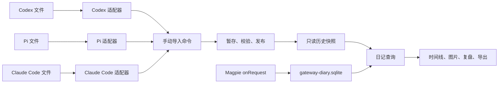

# 本机 Agent 历史导入设计

## 目标

用户可以独立运行历史导入命令，把本机各 Agent 已保存的用户输入补进 Prompt Diary。导入开始、失败或被中断时，Magpie 继续采集新输入，页面继续读取已发布的数据。增加一个 Agent 只需增加该 Agent 的适配器、注册项和测试。

## 修改前结构

`captureRequest` 在事务中写请求观测、会话边界、Prompt 和图片。`loadRecords` 读取该库，负责整理时间和项目。图片预览另外按卡片关联读取字节。旧版历史导入曾通过 Magpie 内部索引发现会话，再分别解析 Codex、Pi 和 Claude Code 的文件。旧备份中有 3,499 条这类原生记录。那批数据的字段可以用来验证迁移覆盖，原生消息与实时网关观测仍有不同的证据来源。

## 修改后结构

| 维度 | 修改前 | 提议结构 | 为什么改 |
| --- | --- | --- | --- |
| 入口 | `onRequest` | 实时使用 `onRequest`，历史使用独立 CLI 进程 | 目录扫描和文件解析耗时不进入请求路径 |
| 记录身份 | 网关消息身份或输入边界 | 实时使用现有 ID，历史使用 Agent、会话和原生消息身份 | 同一历史重复导入结果稳定，独立同文提交仍各有 ID |
| 写入所有权 | 实时库由网关钩子写入 | CLI 只发布历史快照 | 批量导入与实时采集没有共同的 SQLite 写事务 |
| 读取 | `loadRecords` 读取实时库 | 查询层读取两种来源，向页面和导出提供同一记录格式 | Markdown、查找、附件和人工标注可复用 |
| 生命周期 | 实时写入对读请求逐条可见 | 历史任务校验完成后整批发布 | 中断或单个 Agent 的解析故障不会暴露半批数据 |

### Agent 适配器

计划放在 `tools/history-import/agents/`。每个模块实现 `discover(options)` 和 `read(session)`。`discover` 根据客户端配置、环境变量、常见目录或 CLI 指定目录枚举会话。`read` 从该客户端版本的结构中提取用户提交，通过异步迭代输出统一记录。目录布局、版本差异、消息类型、原生身份、项目字段和附件定位都归适配器。新增 Agent 可接受独立验收。

| 适配器 | 需要各自处理的差异 |
| --- | --- |
| Codex | 会话和归档目录，用户事件与转录项的对应关系，压缩后的重放 |
| Pi | 会话文件及分支链，用户输入、扩展自定义消息和压缩摘要的类型差异 |
| Claude Code | 按项目组织的会话，元数据、子 Agent、工具结果与实际用户输入的区分 |
| OpenCode 等 | 按实际安装版本核对数据库或文件布局，再确定消息和附件身份 |

统一记录包括 `id`、`source = native_history`、`agent`、`sessionId`、`submittedAt`、`cwd`、`text` 和附件。优先用原生消息 ID。缺少 ID 时，仅在格式能证明事件位置对追加、重启和归档移动稳定的情况下用原生事件定位符。没有稳定定位符的消息计入待确认数量。读取会话目录或附件由适配器完成，附件需能关联到该条消息，并按字节校验类型和大小。图片无法恢复时仍可保留该条正文，并在报告中计数。

### 独立任务与发布

1. 默认执行预览。按 Agent 报告会话数、候选数、可导入数、重复数、缺失附件和解析失败原因。可指定 Agent 和目录。目录未找到和格式暂不支持分别报告。
2. `--apply` 在独立进程中流式扫描，并写同目录暂存 SQLite。已发布快照作为基线，按稳定 ID 增量合并，源文件移走或过期时已导入卡片仍可查。并发发布由只作用于导入进程的互斥锁串行化。
3. 每个 Agent 的写入单独校验。预期的单条格式问题跳过并计数，整类读取失败时保留该 Agent 的上次结果，其他 Agent 可继续。最终快照带 schema 版本，通过结构和完整性检查后关闭临时数据库，确保发布物是完整的单个 SQLite 文件，再在同一文件系统原子替换 `native-history.sqlite`。中断时继续使用上一版，保留上一版可供回退。
4. 日记在一次页面请求中持有同一份历史快照句柄，卡片正文和图片由同一版本提供。文件缺失或不可用时，页面仍可读取实时数据。翻页如果跨历史快照版本，显示刷新提示。页面、复盘和导出只读取已发布记录。复盘在任务开始时固定选中的 Prompt 文本。

### 去重与现有功能

- **历史内部**按 `Agent + 原生会话 ID + 原生消息身份` 去重。多次导入、移动会话文件或同时发现会话和归档时，重复的原生消息保留同一 ID。
- **历史与实时之间**仅凭可验证的共同消息身份合并。能确认时保留已有网关卡片 ID 和关联。文本相同、时间相近只作为核查线索。历史卡片显示「本机历史导入」，来源详情可查；网关卡片的观测关联继续保存在实时库。
- 收藏、标签、隐藏状态和模板继续由现有标注存储管理。导入器只写归档和任务报告。旧版标注如果要迁移，需先验证原记录 ID 的对应关系。
- 实时钩子和插件启动路径与导入工具解耦。网页侧的新增职责限于读取快照、展示来源和选取附件。首版验证 Codex、Pi、Claude Code，其他 Agent 按本机实存格式逐个接入。

## 验收

| 场景 | 预期结果 |
| --- | --- |
| 只有部分 Agent 已安装，或某一目录改了位置 | 其他 Agent 正常发现和导入，报告可区分未安装、找不到目录和格式不支持 |
| 每个 Agent 提供正常消息、工具输出、压缩摘要和相同正文的两次提交 | 只导入实际用户提交，两次同文记录各有一张卡片 |
| 反复执行，移动归档目录，或两个进程同时执行导入 | 记录 ID 和标注稳定，发布串行，卡片数不因重跑增长 |
| 导入进程中断、部分 Agent 失败或历史快照不可用 | 网关继续收录新输入，页面可读取实时数据及可用的上一版历史 |
| 导入前后访问时间线、搜索、筛选、图片、复盘和导出 | 两种来源都可使用现有功能，正文与图片来自同一份快照，导出保留来源信息 |
| 同一条输入同时出现在网关和本机会话 | 可核验同一身份时显示一张卡片，已有标注仍可查 |

## 实施顺序

1. 定义适配器契约和快照结构，先完成预览和每个 Agent 的样本验证。
2. 加入暂存、合并、原子发布与独立的历史读取接口，验证导入中断时实时采集能继续。
3. 接入时间线、图片、复盘和导出。用本机实际会话跑预览，按 Agent 报告覆盖和重复情况。

当前网关入口和数据模型见 [Magpie 网关采集架构](magpie-gateway-architecture.md)。
