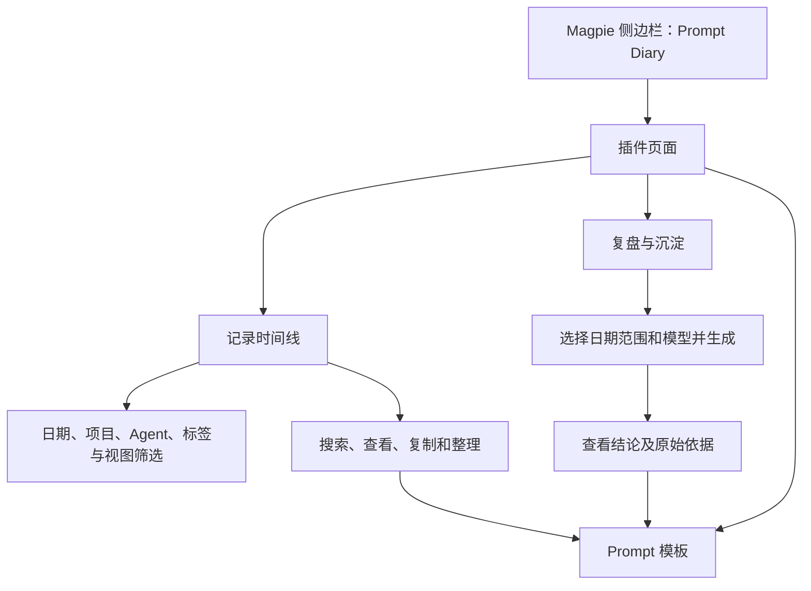

# Prompt Diary 产品文档

> 状态：当前版本说明与产品方向，基于 2026-11-23 的仓库实现和需求讨论整理。涉及后续方向的内容仅供讨论，不代表已经实现或确定排期。

## 1. 产品定位

Prompt Diary 是运行在 Magpie 中的个人 Prompt 工作台。它帮助用户收集、查找和回顾使用不同 Agent 时输入的内容，并在用户主动触发时，从记录中提炼问题、重复提醒和可复用的 Prompt。

产品从“完整 Prompt 清单”出发：尽量保留可获取的用户输入，支持按原始文本查找与回溯；复盘和提炼建立在记录之上。由于采集来源和历史接口存在限制，当前版本不能保证收录用户输入过的每一条 Prompt，也不是审计系统。

### 目标用户

主要面向通过 Magpie 使用多个 Agent 的个人开发者，优先关注 Codex、Pi 和 Claude Code。实时采集覆盖的是符合条件、经过 Magpie 网关的请求；历史导入当前仅支持上述三类 Agent 的可读取原生会话。

### 用户要解决的问题

- **找回输入**：记得问过某个问题，却忘了发生在哪一天、哪个项目或 Agent 中。
- **回顾思路**：按时间查看当时提出的问题和后续补充，辅助还原工作过程。
- **发现重复提醒**：识别跨会话反复提出的要求，作为整理个人或项目规则的线索。
- **复用好 Prompt**：收藏有价值的输入，将其编辑并保存为模板。

以上是产品目标；当前复盘依据用户输入进行推断，不能证明任务完成，也不能自动还原完整排障过程。

## 2. 产品原则

1. **不打断工作**：采集在后台进行，不在发送 Prompt 时要求用户分类、标注或确认。
2. **尽量保留原始输入**：低信息量的输入也可能对回顾过程有意义；不因内容看起来简单就自动删除。
3. **谨慎去重**：相同文本可能是不同时间的真实输入，应结合消息和会话身份判断，不能只按文本相等去重。
4. **提炼可追溯**：复盘结论提供原始 Prompt 依据，用户可以自行判断；不自动修改规则文件。
5. **界面以文字为中心**：时间线紧凑，图片和附加信息按需展开，常用查找和复制操作容易访问。
6. **数据流向明确**：采集数据保存在本机；只有用户主动生成复盘时，才会把所选范围内的 Prompt 文本发送给所选模型。

## 3. 产品结构

## 4. 当前功能与规则

### 4.1 采集与初始化

- 安装并启用插件后，符合条件且经过 Magpie 网关的用户文本会以本机日期写入每日 Markdown。采集不修改模型请求。
- 启动时后台同步 Magpie 已索引且允许读取的 Codex、Pi 和 Claude 原生会话。重新启用插件可再次同步；历史快照与实时 Markdown 分开保存，页面合并展示。
- 历史和实时记录仅在能够判断为同一原始消息时合并。身份或时间信息不足时，仍可能出现重复或遗漏；不通过简单的文本相等规则删除真实重复输入。
- 已收录数量和活动日历仅反映插件读到的记录。未索引、无权限、被截断或无法匹配时间的历史消息可能缺失。

### 4.2 浏览与筛选

- 记录按天分组，以时间线和卡片展示；时间正序、倒序可以切换，向下滚动时逐步加载更多。
- 活动日历每次显示一个自然月，可以切换月份和选择具体日期。时间范围提供全部、当天、本周、近 7 天和近一个月。
- 记录视图包括全部、有图片和已收藏；还可以按项目、Agent 和标签筛选。搜索针对 Prompt 文本，匹配内容以黄色高亮，复制原文不受高亮影响。
- 多个筛选条件可以叠加。点击侧边栏“全部”会取消具体日期选择；时间范围和其他筛选仍可能生效。
- 侧边栏保持在视口内，内容过长时可以滚动，滚动条不显示；主题颜色跟随 Magpie 提供的主题。

### 4.3 项目列表

- 项目来自记录的工作目录，并不等同于用户维护的项目清单。可确认的 Git 工作区按仓库根目录归类；普通目录和无法确认的历史路径继续保留并标明状态。
- 不同路径下的同名目录会区分，并显示父路径提示。原始工作目录仍保留在记录来源中。
- 项目列表按最近活跃时间排序，默认显示最多 6 个匹配项目，其他项目可展开查看；已选项目不在前 6 项或当前匹配数为零时也额外保留，方便取消。
- 每个项目显示在当前其他筛选条件下的记录数；项目标题显示当前匹配项目数与全部历史目录数。计算项目候选数时排除当前项目筛选本身。
- 路径的可访问状态可能随时间变化，因此项目归类也可能变化；目前没有手动隐藏、合并或拆分项目的界面。

### 4.4 卡片、图片与整理

- 卡片默认突出文本，时间显示在左侧时间线上；更多操作在卡片右侧菜单中。标签、来源和可读取的图片默认隐藏，可一起展开。
- 图片可点击放大，同一条记录有多张图片时可以使用按钮、方向键或滑动切换。图片是否可读取取决于来源和本地文件状态。
- 可以复制完整原文；选中文字后通过出现的复制按钮复制选中部分，并显示结果提示。
- 可以收藏、添加或移除标签、隐藏记录，以及将 Prompt 编辑后保存为模板。收藏和标签等状态与原始会话分开保存。
- **已知缺口**：卡片可以隐藏记录，代码支持查看和恢复隐藏记录，但当前侧边栏没有“已隐藏”入口。恢复流程需要补齐入口或另行明确产品设计。

### 4.5 复盘与模板

- 用户在“复盘与沉淀”中选择日期、范围和 Magpie 可用模型后手动生成。当天复盘包括核心问题、重复纠偏线索和可复用 Prompt 候选；近 7 天复盘聚焦跨日、跨可识别会话的重复提醒。
- 结论可展开查看原始 Prompt；候选可以标记为不值得，或收藏原始记录并保存为模板。模板可在模板页面复制、编辑和删除。
- 生成时发送选定范围内的 Prompt 文本，不发送附件图片。模型可能由本地或远端服务提供；实际数据流向取决于用户所选模型。
- 复盘有输入条数和长度限制，页面说明不完整记录数。重新生成同日期、范围的报告会替换原报告；生成失败保留原报告。

## 5. 主要用户流程与验收要点

### 找回一条 Prompt

1. 打开 Magpie 中的 Prompt Diary，使用搜索词或日期、项目、Agent 等条件缩小范围。
2. 在时间线中定位记录，查看高亮内容；需要时展开来源和图片。
3. 复制原文或选中其中一段文字进行复制。

**验收要点**：筛选条件叠加时结果和项目计数应一致；文本高亮不改变复制内容；搜索或切换条件不应整页闪烁或丢失可用的侧边栏状态。

### 回顾并沉淀

1. 打开“复盘与沉淀”，选择日期、范围和模型。
2. 主动生成并等待结果；查看每条结论对应的原始 Prompt。
3. 对候选做反馈，或将原始 Prompt 保存为模板，之后在模板页编辑和复制。

**验收要点**：用户能够知道生成使用的范围和不完整情况；结论可以追溯到来源；模型请求不包含附件图片；生成失败不覆盖已有报告。

## 6. 数据与隐私边界

- 默认记录、历史快照、标注、附件及报告保存在本机日志目录；这些内容可能包含敏感信息，当前不自动脱敏。
- 删除每日 Markdown 不会自动删除独立保存的历史快照和图片。隐藏记录是展示状态，不等于删除数据。
- 本地页面服务仅监听本机地址；其他本机程序仍可能访问该服务。远程 Magpie Web 不支持直接访问本机页面。
- 图片支持范围、采集来源、历史同步和日志权限的详细限制见 [README](../README.md)。

## 7. 已讨论但未实现的方向

以下内容用于后续产品讨论，不代表承诺实现或排期：

- 项目手动隐藏、合并与取消合并；处理失效路径和项目别名。
- 更好地呈现复盘生成的覆盖范围与历史采集不完整原因。
- 将重复纠偏整理为可供用户确认和复制的工程规范；是否支持写入规则文件需要单独设计。
- 更完善的模板组织，以及排除指定项目、删除和脱敏等数据管理能力。
- 自动定时复盘、分享或团队知识库：目标用户、权限和数据流向尚未确定。

## 8. 待团队讨论的问题

1. 对 monorepo、Git worktree 和一个目录包含多个项目的情况，用户希望采用什么项目边界？
2. 历史路径不可访问或归类结果变化时，如何让用户修正项目，且不丢失已有收藏和标签？
3. 隐藏记录的恢复入口放在哪里，是否需要独立的记录管理页面？
4. 复盘质量和价值如何衡量：依据可追溯性、用户反馈、模板复用率还是其他指标？目前尚未建立衡量机制。
5. 用户希望怎样控制敏感数据进入复盘，以及是否需要排除特定目录或记录？

## 9. 文档维护

产品行为、边界或数据流向发生变化时，相关功能负责人应同步更新本文和 README；新需求应标明是现状、计划还是待决问题，并补充用户流程和验收条件。涉及实现细节时，以代码及测试为准，发现文档与实际不一致应及时修正。
